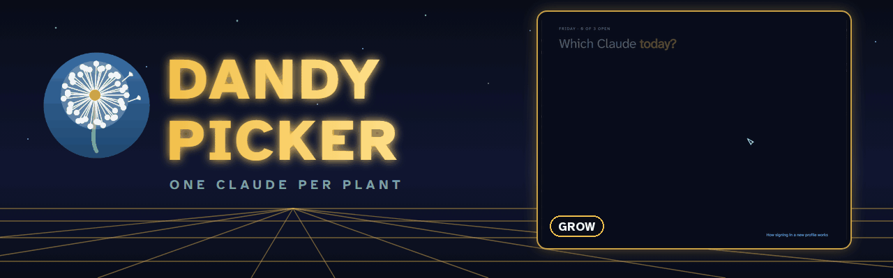
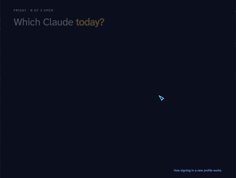
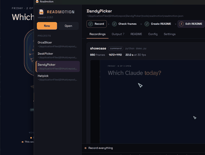
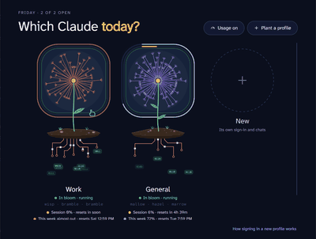
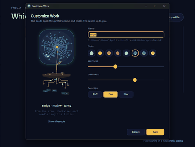
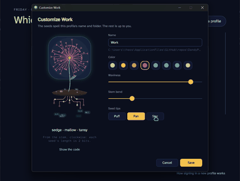

<p align="center">
  
</p>

<p align="center">
  
  
  
  
</p>

<p align="center">
  <a href="#what-it-does">What it does</a> ·
  <a href="#see-it-in-action">See it in action</a> ·
  <a href="#getting-started">Getting started</a> ·
  <a href="#building">Building</a> ·
  <a href="#history">History</a>
</p>

<table>
<tr>
<td width="52%"></td>
<td>

### One Claude per plant

Run Claude Desktop with more than one account at the same time, e.g. work and personal side by side. Named for the Claude logo looking like a dandelion.

</td>
</tr>
</table>

> [!NOTE]
> Plan usage is off by default. Turning it on reads each profile's sign-in token and sends it to api.anthropic.com only; see [Plan usage](#plan-usage-off-by-default).

## What it does

- **Several accounts at once.** Each profile is its own Claude Desktop with its own data folder, so work and personal run side by side, each signed in.
- **Each profile is a plant.** It grows from the profile's name and folder: the seeds spell them out, and no two plants grow alike.
- **Plan usage at a glance, if you want it.** Opt in to see each profile's session and weekly usage as rings round its flower.
- **Sign-in hand-off.** It catches the `claude://` sign-in link from your clipboard and sends it to the profile that asked.

## How it works

Claude Desktop is an Electron app. Starting it with
`--user-data-dir="<folder>"` gives that instance its own data folder, which
means its own sign-in, chats and settings, and its own single-instance lock, so
it runs alongside the normal one. DandyPicker keeps a list of these profiles
and launches each with the right folder.

Each profile is a plant: a dandelion on a stem, growing from a patch of soil
with circuit-board roots. When the window opens they grow in one after another.

- **Open**: start a profile. A running one shows **Show window** instead,
  which brings it to the front. While it runs, its frame glows, and white dots
  run down its roots and leave as little packets of its own bits. When it
  closes, its seeds wilt toward the ground and its leaves fold up.
- **Click the plant** to customize it: name, color, waviness, stem bend and
  seed tips. Hovering makes it sway.
- **⋯ menu**: **Customize**, **Send sign-in link** (see below), **Open data
  folder**, **Desktop shortcut** and **Remove from list**. Removing never
  deletes the profile's data folder.
- **Open data folder** goes to the folder Claude really uses. Claude is a
  packaged (MSIX) app, so Windows may keep the files in the package's private
  copy of AppData rather than the path shown.

The plant is grown from the profile's name and folder. Starting just clockwise
of the stem, each seed is one of four lengths (2 bits), so four seeds spell one
byte of `name/folder`: the picture can be read back like a QR code (**Show the
code** in the Customize window). The same text also hashes to three seed
words, like `mallow · hazel · marrow`, which name the flower, pick its default
color, and seed its soil, pebbles and roots, so no two profiles grow alike.
Each plant has one leaf per place in the list: profile 1 has one leaf. The look
you choose never changes what the seeds say.

Profiles are stored in `profiles.json` next to the .exe. An empty `dataDir`
means Claude's default folder; `color`, `wave`, `bend` and `tips` (the
flower's look) are optional.

## Plan usage (off by default)

**Usage off/on** in the corner can show each profile's 5-hour session and
weekly usage as two rings round its flower (gold for the session, blue for the
week, coral when nearly out), with the reset times under its name.

There's no public API for this, so it's off unless you turn it on, and turning
it on first explains what it does. When on, DandyPicker reads the sign-in token
Claude Desktop keeps in each profile's `config.json` (decrypting it with your
Windows account's key, as Claude does) and sends it to api.anthropic.com only,
every few minutes, to the usage address Claude Code's `/usage` uses. It never
renews the token, so it can't sign a profile out. Claude keeps the token fresh
while the profile is open; once it has expired, DandyPicker falls back to the
profile's claude.ai sign-in cookie, which Claude only unlocks while the
profile is closed. Tokens and cookies are kept in memory just for that request.
These are unofficial addresses, so it may stop working at any time. When new
numbers can't be read, the last ones stay up, marked "as of" their time; with
none to show, the profile says "Usage unavailable" with the reason.

To see the rings with made-up numbers, without reading any sign-in, start
`DandyPicker.exe --demo-usage`. The setting is saved in `settings.json`.

## Signing a new profile in

Google sign-in finishes in your browser, which hands the result back with a
`claude://` link. Windows always sends those links to the default Claude
window, never to the profile that asked. So:

1. Open the new profile and start signing in from its window.
2. When the browser asks "Open Claude?", cancel.
3. Right-click the page's Open Claude button and copy the link.
4. Switch back to DandyPicker. It sees the `claude://` link on the clipboard
   and shows a **Send to <profile>** button for each running profile. You can
   also paste the link yourself from the profile's ⋯ menu.

## See it in action

Every clip is the real project, recorded with Readmotion. Nothing is mocked up.

<table>
<tr>
<td align="center"><br><b>Grow</b>: the profiles grow in, one after another</td>
<td align="center"><br><b>Sway</b>: hover a plant and it sways</td>
</tr>
<tr>
<td align="center"><br><b>Customize</b>: color, waviness, stem bend and seed tips</td>
<td align="center"><br><b>Code</b>: the seeds spell the profile's name and folder</td>
</tr>
</table>

## Getting started

1. Build it with `build.cmd` (see [Building](#building)) and run `DandyPicker.exe`.
2. Click **Plant a profile** for each account, then **Open** it.
3. Sign in from that profile's window; see [Signing a new profile in](#signing-a-new-profile-in) for Google sign-in.

## Building

DandyPicker is C# with [Avalonia](https://avaloniaui.net/). `build.cmd`
publishes a single self-contained `DandyPicker.exe` into the repo folder. It
needs the .NET 10 SDK. Close DandyPicker first. The plants are drawn and
animated by `src\PlantView.cs` from the layout in `src\Plant.cs`.

The text is [Atkinson Hyperlegible](https://www.brailleinstitute.org/freefont/)
Next and Mono, bundled from `assets\fonts` under the SIL Open Font License
(`assets\fonts\OFL.txt`).

`dandelion.ico` is drawn by `tools\make-dandelion-icon.ps1`:

```powershell
.\tools\make-dandelion-icon.ps1 -OutIco dandelion.ico -OutPreview dandelion.png
```

`claude.ico` (used for per-profile desktop shortcuts) is extracted from the
installed Claude app and isn't tracked:

```powershell
Add-Type -AssemblyName System.Drawing
$exe = Join-Path (Get-AppxPackage Claude).InstallLocation 'app\Claude.exe'
$fs = [IO.File]::Create("$PWD\claude.ico"); [Drawing.Icon]::ExtractAssociatedIcon($exe).Save($fs); $fs.Close()
```

## Development

```
assets/   fonts: Atkinson Hyperlegible (SIL OFL)
src/      the app: Avalonia on .NET 10; the plants are PlantView.cs and Plant.cs
tools/    the icon maker, and readmotion/: the config, demo profiles and driver that record this README's media
```

### Recording the README media

The GIFs above are made with Readmotion from `tools/readmotion/readmotion.json`. It runs a copy of the app from `tools/readmotion/.work/demo/` with the made-up profiles in `demo_profiles.json` and usage off, so no real profile or sign-in is touched, and `driver.py` moves the mouse. Close DandyPicker (it runs one copy at a time) and build the demo copy first, since building is slower than the recording waits:

```
python tools/readmotion/demo.py --build
```

Then open the config in the Readmotion app and click **Record all**, then **Create README**, or from a terminal. Keep the screen unlocked and the window uncovered while it records:

```
readmotion-cli capture tools/readmotion/readmotion.json
readmotion-cli build tools/readmotion/readmotion.json
```

## License

Fonts: AtkinsonHyperlegibleMono, AtkinsonHyperlegibleNext (each under its own license, in the repo).

## History

The commits before "Set up git" were reconstructed from the chat the tool was
built in, dated to when each version was made. Each milestone is tagged:

| Tag | Version |
|---|---|
| `v0.1-powershell` | PowerShell + WinForms switcher |
| `v0.2-sign-in-link` | Send sign-in link |
| `v0.3-dandelion-icon` | Dandelion icon |
| `v1.0-exe` | Compiled C# app |
| `v1.1-dandypicker` | Renamed to DandyPicker |

To get any version as its own folder:

```powershell
git worktree add ..\DandyPicker-v0.1 v0.1-powershell
```
